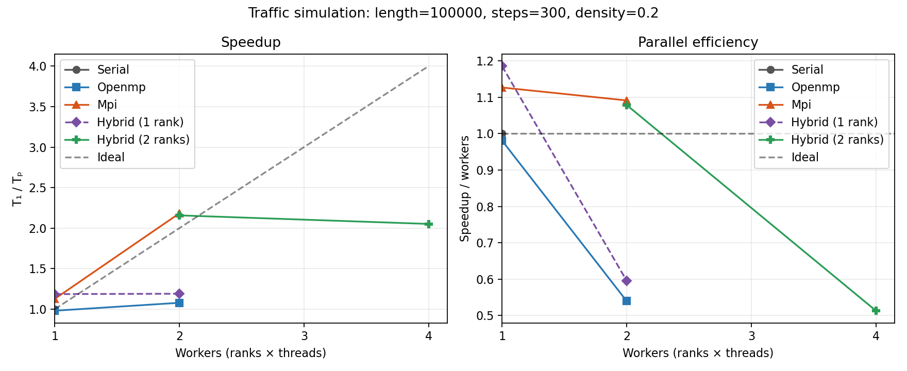
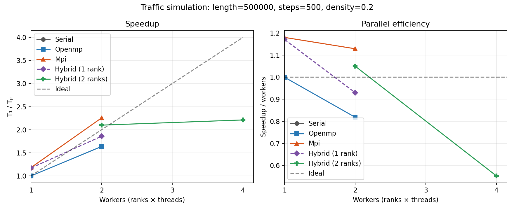

# Traffic Flow Simulation — Presentation Content

**Suggested length:** 10–12 minutes, including the live demonstration.  
**Audience:** classmates and instructor; assume they know basic programming but may not know NaSch, OpenMP, or MPI.  
**How to use this file:** Each numbered section is one slide. Put the **Slide content** on the slide; use **Speaker notes** to explain it aloud. Visual suggestions are optional. The measured results and commands below match the files in this repository.

---

## Slide 1 — Traffic Flow Simulation

### Slide content

- Parallel implementation of the Nagel–Schreckenberg traffic model
- C++17 · Serial · OpenMP · MPI · Hybrid MPI + OpenMP
- **Goal:** compare correct implementations and measure how execution time changes with parallel workers
- Presenter(s): *add names* · Course: Parallelization of Algorithms

### Speaker notes

This project simulates cars on a one-lane circular road. We implemented a sequential version and parallel versions using shared-memory threads, distributed-memory processes, and both together. We check the parallel results against serial and compare their measured run times.

### Visual

Show a simple circular road with several cars, or a screenshot of a simulation concept. No simulation animation is required by the current program.

---

## Slide 2 — Problem and motivation

### Slide content

- Traffic is a system of many vehicles whose movement depends on nearby vehicles.
- Even simple local rules can produce slowdowns and stop-and-go flow.
- **Question:** can we simulate many vehicle updates faster by splitting the work across threads or processes?
- **Scope:** one lane, discrete road cells, circular boundary (ring road).

### Speaker notes

The road is circular so a car leaving the last cell continues at the first. This avoids special road-end behavior and gives a compact model for comparing parallel algorithms. Each car's update depends on its own speed and the gap to the next car, which creates work we can distribute.

---

## Slide 3 — Nagel–Schreckenberg model

### Slide content

For each car, once per time step:

1. **Accelerate:** increase speed by 1, at most `vmax`.
2. **Brake:** limit speed to `gap − 1` so the car does not reach the next car.
3. **Random slowdown:** with probability `slowdown`, reduce a positive speed by 1.
4. **Move:** advance by the resulting speed; wrap around the ring.

**Inputs:** road length, number of steps, density, `vmax`, slowdown probability, random seed.

### Speaker notes

This is the standard four-rule NaSch update. The update is synchronous: every car calculates its new speed and position from the state at the beginning of the step. Cars do not read a neighbor's partially updated state. A fixed seed makes the run repeatable. Random draws are based on seed, vehicle ID, and step, so changing thread or rank scheduling does not change which random slowdown a particular car receives.

The code stores ordered arrays of vehicle positions and speeds rather than a cell array. The braking rule prevents overtaking, so vehicle order remains valid.

### Visual

Use a small road/ring drawing. Show a car, the forward gap to the next car, and a four-arrow update sequence.

---

## Slide 4 — Program structure and serial reference

### Slide content

```text
Build executable → create initial state → repeat update for each step
                 → report mean speed / flow → optionally verify or write CSV
```

- `src/traffic_sim.cpp`: model, execution modes, timing, metrics, verification
- Serial mode: reference algorithm and performance baseline
- Flow metric: `number of cars × mean speed ÷ road length`
- `--verify`: exact final position and speed comparison against serial

### Speaker notes

CMake compiles the C++ source into one executable. Its `--mode` option selects how the work is executed. The serial mode is important because it provides a straightforward implementation to compare against. Verification reruns the same input with the serial algorithm and checks both ordered position and speed arrays for exact equality.

---

## Slide 5 — How the work is parallelized

### Slide content

| Mode | Work distribution | Data exchange |
|---|---|---|
| Serial | One process, one thread | None |
| OpenMP | Threads split vehicle loop on one shared-memory machine | Shared read-only old state; disjoint new-state slots |
| MPI | Ranks own contiguous vehicle-ID blocks | Exchange next block's first position (boundary/halo) each step |
| Hybrid | MPI divides blocks; OpenMP threads update within each block | MPI exchange before threaded update |

### Speaker notes

In OpenMP, every thread reads the old positions and speeds, and each iteration writes a different index in the new arrays. The loop barrier ensures all new values are ready before the arrays swap.

In MPI, rank 0 initializes the ordered state and `MPI_Scatterv` distributes nearly even contiguous blocks. Each rank updates only its own cars. To calculate the final car's gap in its block, it needs the first car position from the next nonempty rank. `MPI_Sendrecv` exchanges that one boundary value. Empty ranks are skipped. The hybrid mode uses exactly this rank ownership, then lets OpenMP threads update the rank-local block. MPI calls stay on the main thread.

### Visual

Draw 12 ordered cars split into three colored rank blocks. Label one exchanged first-car position as the halo. Within one block, show two threads writing separate output indices.

---

## Slide 6 — Correctness and reproducibility

### Slide content

- Same model parameters and seed across modes
- `--verify` compares final positions **and** speeds exactly to serial
- CTest result: **7 / 7 passed**
  - Serial: 1 test
  - OpenMP: 1 and 2 threads
  - MPI: 2 and 3 ranks
  - Hybrid: 2 ranks × 1 and 2 threads
- Extra edge case passed: 4 ranks, 2 threads/rank, only 2 cars (some ranks empty)

### Speaker notes

The deterministic random function makes exact comparisons possible even when the work runs in a different order. The CTest cases exercise the main configurations and each uses `--verify`. The edge case checks that ranks with no assigned cars do not break boundary communication. These are correctness checks, not benchmark runs.

### Optional live command

```sh
ctest --test-dir build-linux-mpi --output-on-failure
```

---

## Slide 7 — Benchmark method

### Slide content

- Same executable build, seed `42`, density `0.2`, and workload across compared modes
- Two workloads: **100,000 cells × 300 steps** and **500,000 cells × 500 steps**
- One warmup; **five measured runs** per configuration; configuration order shuffled
- Reported value: median elapsed time
- MPI timing: ranks synchronize; use the **slowest rank's** elapsed time
- Excluded: initialization, final gather, and verification
- Speedup = serial median ÷ parallel median
- Efficiency = speedup ÷ requested workers (`ranks × threads`)

### Speaker notes

The Python benchmark script launches the C++ executable repeatedly. It saves all five measured samples in a raw CSV and the median plus derived metrics in a summary CSV. No per-step CSV is collected during benchmark runs because that would add work and MPI communication to the timed loop.

The host was WSL2 with two logical CPUs (one physical core with two hardware threads); Open MPI reported one slot, so oversubscription was enabled for multi-rank runs. These measurements compare the requested configurations on that host. They do not establish how the program scales on a many-core server.

---

## Slide 8 — Speedup and efficiency graphs

### Slide content

**100,000 cells × 300 steps**



**500,000 cells × 500 steps**



### Speaker notes

The horizontal axis is requested workers; the left panel shows speedup and the right panel efficiency. MPI and hybrid configurations add communication and coordination, so the best configuration depends on workload and available hardware. On the larger case, OpenMP's two-thread speedup improves compared with the smaller case, which is consistent with parallel work becoming more substantial relative to overhead.

Efficiency slightly above 1 appears in some one- and two-worker measurements. Treat that as timing variability on this small virtualized host, not as a general claim of superlinear scaling. The four-worker hybrid case requests more workers than the host's two logical CPUs.

---

## Slide 9 — Representative measured results

### Slide content

| Workload | Serial median | OpenMP 2 threads | MPI 2 ranks | Hybrid 2 ranks × 1 thread | Hybrid 2 ranks × 2 threads |
|---|---:|---:|---:|---:|---:|
| 100k cells × 300 steps | 0.0356 s | 1.079× | 2.183× | 2.158× | 2.052× |
| 500k cells × 500 steps | 0.3060 s | 1.637× | 2.257× | 2.099× | 2.211× |

**Interpretation:** MPI with 2 ranks is about 2.2× faster than the serial median in these runs. OpenMP shows a larger speedup on the larger workload. Four-worker hybrid gives only a small improvement over two-worker hybrid on this two-logical-CPU host.

### Speaker notes

These are measured medians from five runs, not theoretical estimates or smoke-test values. For the larger workload, the serial median is 0.3060 seconds, OpenMP with two threads is 0.1870 seconds, MPI with two ranks is 0.1356 seconds, and hybrid with two ranks and two threads is 0.1384 seconds. Because the hybrid configuration asks for four workers on a two-logical-CPU allocation, it cannot use four physical execution resources. The raw sample files are in `results/benchmark_*_raw.csv`; the summary CSV files contain all configurations.

---

## Slide 10 — Challenges, choices, and limitations

### Slide content

**Challenges addressed**

- Preserve synchronous updates while parallelizing car calculations
- Keep vehicle IDs and random slowdown choices consistent across modes
- Supply each MPI block with the next car's boundary position
- Handle ranks assigned zero cars
- Measure distributed time using the slowest rank

**Limitations**

- Results are from a constrained two-logical-CPU WSL2 host
- Only two workload sizes, one density, and one seed were measured
- MPI initializes the full state on rank 0 before scattering it

### Speaker notes

The old-state/new-state arrays avoid write conflicts and preserve the model's synchronous rules. Stable global vehicle IDs let every mode use the same slowdown draw. In MPI, explicit ownership reduces duplicated update work, while the halo provides the one remote value needed at a block boundary. Timing uses barriers and the maximum rank time so faster ranks do not make the reported result look better than the slowest rank. A useful next experiment would be more workload parameters on a dedicated multicore system.

---

## Slide 11 — Live demonstration and conclusion

### Slide content

1. Run a small serial verification.
2. Run hybrid verification with multiple ranks and threads.
3. Show the benchmark summary and saved graph files.

**Conclusion:** the project implements and verifies serial, shared-memory, distributed-memory, and hybrid traffic simulation, and provides measured comparisons for the available host.

### Demo commands

```sh
./build-linux-mpi/traffic_sim --mode serial \
  --length 2000 --steps 40 --density 0.22 --seed 17 --verify

OMP_NUM_THREADS=2 mpirun --oversubscribe -np 2 \
  ./build-linux-mpi/traffic_sim --mode hybrid \
  --length 2000 --steps 40 --density 0.22 --seed 17 --verify

cat results/benchmark_500k_500.csv
```

### Speaker notes

Point out that both commands use the same input and seed and that verification reports `PASS`. Briefly identify the serial baseline and parallel configuration in the summary CSV, then show how the graphs present speedup and efficiency. Close by stating that larger hardware and more workload settings are needed for broader scalability conclusions.

---

## References and project artifacts

- Nagel, K. and Schreckenberg, M. (1992). “A cellular automaton model for freeway traffic.” *Journal de Physique I*, 2(12), 2221–2229. [doi:10.1051/jp1:1992277](https://doi.org/10.1051/jp1:1992277).
- OpenMP API specifications: [OpenMP specifications](https://www.openmp.org/specifications/).
- MPI standard documents: [MPI Forum documents](https://www.mpi-forum.org/docs/).
- Build, run, test, and benchmark commands: [`README.md`](README.md).
- Raw benchmark samples and summaries: [`results/`](results/).
