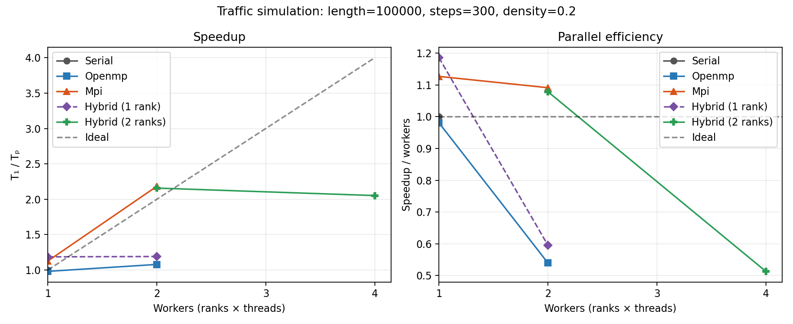
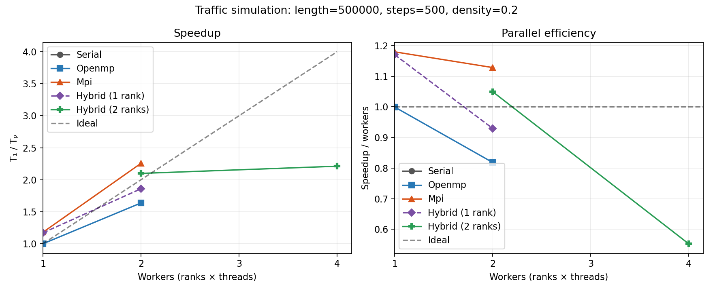

# Traffic Flow Simulation

A C++17 Parallelization of Algorithms project implementing the Nagel–Schreckenberg cellular automaton on a one-lane ring road. The program includes a sequential reference, OpenMP, MPI, and hybrid MPI+OpenMP execution, deterministic runs, state verification, CSV time series, and benchmark/plot tools.

## Model

The road has `length` cells. Each cell is empty or contains one car with speed from zero through `vmax`. Cars update synchronously from the previous time step:

1. Accelerate by one, up to `vmax`.
2. Brake to avoid reaching or passing the next car.
3. With probability `slowdown`, reduce a positive speed by one.
4. Move by the resulting speed, wrapping around the ring.

Cars are stored in cyclic vehicle-ID order. Since braking prevents overtaking, that order stays valid. Random slowdowns are hash draws keyed by seed, global vehicle ID, and step, so every mode receives the same random values regardless of rank or thread scheduling. The reported flow is `car_count * mean_speed / road_length`.

## Implementations and ownership

- **Serial:** Updates all cars in order and serves as the correctness and performance reference.
- **OpenMP:** Threads read the immutable old state and write disjoint slots in the next-state arrays. The loop barrier completes each step before the state arrays are swapped.
- **MPI:** Rank 0 initializes the ordered vehicle list and scatters contiguous, nearly even vehicle-ID blocks. Each rank owns and updates only its block. Per step, ranks exchange one boundary position with the next nonempty rank; empty owners are skipped. A final gather is used for reporting and verification.
- **Hybrid:** MPI assigns each rank its block; OpenMP threads update disjoint output slots within that block. MPI calls remain on the main thread (`MPI_THREAD_FUNNELED`), and communication occurs before the threaded update.

The speed and position of each vehicle are updated from the old state, so the parallel loops have no write conflicts. `--verify` gathers the final distributed state and compares positions and speeds exactly against the sequential implementation with the same inputs.

## Build on Linux or WSL

Install the compiler, CMake, Open MPI, and Python plotting dependency if needed:

```sh
sudo apt update
sudo apt install build-essential cmake libopenmpi-dev openmpi-bin python3-matplotlib
```

Build all four modes with CMake. Selecting `mpicxx` explicitly avoids MPI compiler-probe problems seen with the default C++ compiler on some WSL installations:

```sh
cmake -S . -B build-linux-mpi \
  -DCMAKE_CXX_COMPILER=mpicxx \
  -DTRAFFIC_ENABLE_MPI=ON \
  -DTRAFFIC_ENABLE_OPENMP=ON \
  -DCMAKE_BUILD_TYPE=Release
cmake --build build-linux-mpi -j2
```

Run the test suite:

```sh
ctest --test-dir build-linux-mpi --output-on-failure
```

This build adds CTest checks for serial and OpenMP, MPI with 2 and 3 ranks, and hybrid with 2 ranks at 1 and 2 threads per rank. MPI CTest runs enable Open MPI oversubscription for constrained hosts.

## Run

```sh
# Sequential reference
./build-linux-mpi/traffic_sim --mode serial \
  --length 100000 --steps 1000 --density 0.2 --verify

# OpenMP
OMP_NUM_THREADS=2 OMP_DYNAMIC=FALSE OMP_WAIT_POLICY=PASSIVE \
  ./build-linux-mpi/traffic_sim --mode openmp \
  --length 100000 --steps 1000 --density 0.2 --verify

# MPI (remove --oversubscribe when the host has enough advertised slots)
mpirun --oversubscribe -np 4 ./build-linux-mpi/traffic_sim --mode mpi \
  --length 100000 --steps 1000 --density 0.2 --verify

# Hybrid MPI + OpenMP
OMP_NUM_THREADS=2 OMP_DYNAMIC=FALSE OMP_WAIT_POLICY=PASSIVE \
  mpirun --oversubscribe -np 4 ./build-linux-mpi/traffic_sim --mode hybrid \
  --length 100000 --steps 1000 --density 0.2 --verify
```

Options: `--mode serial|openmp|mpi|hybrid`, `--length CELLS`, `--steps N`, `--density 0..1`, `--vmax N`, `--slowdown 0..1`, `--seed N`, `--verify`, and `--csv FILE`. `--csv` writes mean-speed and flow values per step. For MPI/hybrid, per-step CSV gathering adds communication inside the timed loop; omit it for performance comparisons. Verification work and the final gather are also outside the reported time.

## Correctness results

Built and run in WSL2 with GCC 13.3.0, CMake 3.28.3, Open MPI 4.1.6, and OpenMP 4.5. The MPI-enabled Release build completed successfully. The final CTest run passed **7/7 tests**:

| Mode | Verification configurations | Result |
|---|---|---|
| Serial | 1,000 cells × 20 steps | Pass |
| OpenMP | 1,000 cells × 20 steps, 1 and 2 threads | Pass |
| MPI | 2,000 cells × 40 steps, 2 and 3 ranks | Pass |
| Hybrid | 2,000 cells × 40 steps, 2 ranks × 1 and 2 threads | Pass |

An additional edge check passed for hybrid with 4 ranks, 2 threads per rank, and only 2 cars (so some ranks owned no cars). All distributed checks used `--verify` and matched the sequential positions and speeds exactly.

## Benchmark method and results

The benchmark runner uses the same seed, density, compiler build, and input for every mode in each workload. It performs one unrecorded warmup per configuration, then five timed runs in shuffled configuration order; the summary uses each configuration's median. It writes every timed sample to a `_raw.csv` file and the medians, speedups, and efficiencies to the corresponding summary CSV.

The timer starts after initialization. MPI and hybrid runs use a start barrier, an end barrier, and the maximum elapsed time across ranks. The max reduction, final gather, and `--verify` reference run are outside the measured interval. CSV collection is disabled during benchmarks. OpenMP dynamic team sizing is disabled, and `OMP_WAIT_POLICY=PASSIVE` is used consistently; on this small WSL allocation it prevents idle hybrid workers from spinning while the main thread waits for MPI communication. Speedup is `median serial time / median mode time`; efficiency divides speedup by requested workers (`ranks × threads`).

The measurements below were collected on a WSL2 allocation exposing two logical CPUs (one physical core with two hardware threads); Open MPI reported only one slot, so `--oversubscribe` was enabled. The 4-worker hybrid configuration therefore exceeds the available CPU allocation. Treat these as results for this host, not as portable hardware performance claims.

| Workload | Serial median | OpenMP 2 threads | MPI 2 ranks | Hybrid 2 ranks × 1 thread | Hybrid 2 ranks × 2 threads |
|---|---:|---:|---:|---:|---:|
| 100,000 cells × 300 steps | 0.035610 s | 1.079× | 2.183× | 2.158× | 2.052× |
| 500,000 cells × 500 steps | 0.306006 s | 1.637× | 2.257× | 2.099× | 2.211× |

The larger run shows the OpenMP speedup increasing with useful work per step. MPI and hybrid also benefit from two ranks on this workload. The four-worker hybrid run is slower than its ideal four-worker line because the machine only exposes two logical CPUs. Some measured one- and two-worker efficiencies exceed 1.0; timing differences on this virtualized host can make a median beat the single serial baseline, so those values should not be read as a general superlinear result.





### Saved benchmark files

- `results/benchmark_100k_300_raw.csv` and `results/benchmark_100k_300.csv`
- `results/benchmark_500k_500_raw.csv` and `results/benchmark_500k_500.csv`
- `results/performance_100k_300.png` and `results/performance_500k_500.png` (each image contains speedup and efficiency panels)

Recreate the larger workload data and graph with:

```sh
python3 tools/benchmark.py \
  --exe ./build-linux-mpi/traffic_sim \
  --output results/benchmark_500k_500.csv \
  --length 500000 --steps 500 --density 0.2 --seed 42 \
  --repeats 5 --warmups 1 --threads 1,2 --ranks 1,2 \
  --modes serial,openmp,mpi,hybrid --oversubscribe \
  --omp-wait-policy PASSIVE

python3 tools/plot_results.py results/benchmark_500k_500.csv \
  --output results/performance_500k_500.png
```

`tools/benchmark.py` accepts other lengths, step counts, thread counts, rank counts, and repeat counts. Python's matplotlib package is required only to create graphs.

## Limitations and remaining submission work

- Performance results are from a constrained, virtualized two-logical-CPU WSL allocation. A dedicated multicore Linux machine would give stronger scalability evidence.
- The results cover two workload sizes, one density, and one seed. Additional density/seed runs and a larger machine would help separate hardware effects and establish broader scaling behavior.
- The MPI implementation initializes the full ordered state on rank 0 before scattering it; initialization is excluded from the kernel timing.
- The live demonstration and course presentation (problem motivation, algorithm descriptions, graphs, challenges, and optimization choices) still need to be prepared. The presentation has intentionally not been created in this project update.

## Windows build

With an OpenMP-capable g++ such as MSYS2 MinGW-w64:

```powershell
g++ -O3 -std=c++17 -Wall -Wextra -fopenmp src/traffic_sim.cpp -o traffic_sim.exe
```

Run serial and OpenMP natively. Use Linux or WSL with MPI installed for MPI and hybrid modes.
